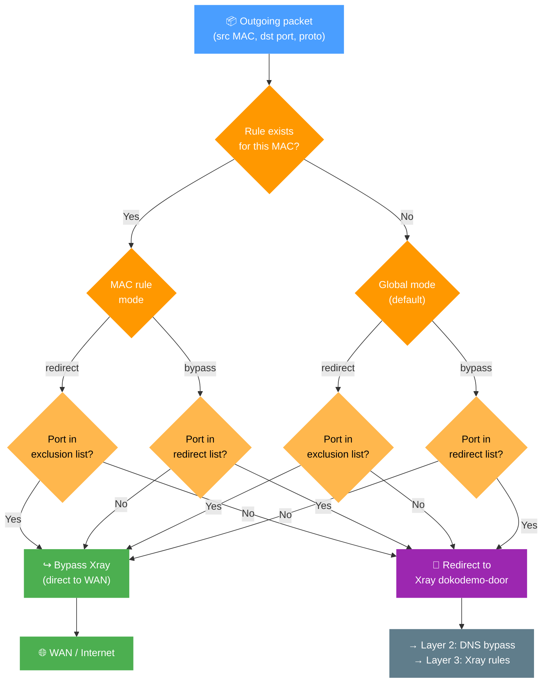

# Bypass/Redirect Policy

The `Bypass/Redirect Policy` allows you to fine-tune how traffic is handled by Xray on a per-port or per-device (MAC address) basis.

- **Bypass** means traffic does **not** go through Xray by default, unless you explicitly specify certain ports to be redirected.
- **Redirect** means traffic **does** go through Xray by default, unless you explicitly exclude certain ports.

> [!info]
> B/R Policies are rules applied just before traffic is routed through the Xray service.

## Why Use It?

You might have devices or applications that you do not want to proxy—perhaps internal services or local game servers.

Conversely, you might want to proxy only specific ports (e.g., `443`) while leaving all other traffic untouched.

Or, you may need a particular device (e.g., your PC) to be fully redirected to Xray, while excluding certain ports for that device.

This flexible policy system lets you achieve all these scenarios and more.

## Policy Schema


To manage B/R Policies, click the **Manage** button in the **Routing** section.

> [!info]
> By default, if no rules are specified, a dynamic general rule is applied: **all traffic is redirected** to the Xray process.

## Decision Logic

The chart below shows how XRAYUI decides whether to intercept a given packet. The check runs at the iptables level before traffic ever reaches Xray.



> [!tip]
> A per-MAC rule always wins over the global rule. Ports act as "mode exceptions": in `redirect` mode they bypass Xray, in `bypass` mode they go into Xray.

## Examples

Below is a table arranged from the simplest configuration (only setting a mode) to more detailed ones (specifying ports and devices). This helps illustrate how different combinations change the final behavior.

| #   | Configuration          | Example (simplified)                | Effect on Devices                                                                               |
| --- | ---------------------- | ----------------------------------- | ----------------------------------------------------------------------------------------------- |
| 1   | Only bypass            | mode: bypass, no MAC/ports          | All traffic `bypasses` Xray (nothing is redirected).                                            |
| 2   | Only redirect          | mode: redirect, no MAC/ports        | All traffic is `redirected` to Xray (no excluded ports).                                        |
| 3   | bypass + port          | mode: bypass, tcp/udp=5060          | Traffic on port 5060 is `redirected` to Xray; all other traffic bypasses Xray.                  |
| 4   | redirect + port        | mode: redirect, tcp/udp=5060        | Traffic on port 5060 `bypasses` Xray; all other traffic is redirected.                          |
| 5   | bypass + MAC           | mode: bypass, mac=AA:BB...          | All traffic for that device `bypasses` Xray (no ports specified to redirect).                   |
| 6   | redirect + MAC         | mode: redirect, mac=AA:BB...        | All traffic for that device is `redirected` (no excluded ports). Other devices are unaffected.  |
| 7   | redirect + MAC + ports | mode: redirect, mac=..., ports=5060 | For that device: traffic on port 5060 bypasses Xray; all other traffic is `redirected`.         |
| 8   | bypass + MAC + ports   | mode: bypass, mac=..., ports=5060   | For that device: traffic on port 5060 is redirected to Xray; all other traffic `bypasses` Xray. |

## Parental Control and Network Services Filter

The firmware's **Parental Control** (time scheduling and blocking) and **Network Services Filter** only add rules to the iptables `FORWARD` chain. Traffic that XRAYUI redirects to Xray never passes `FORWARD`: it is delivered to Xray on the router, and Xray then opens its own connection from the router. As a result, those firmware rules **do not apply** to any device whose traffic goes through Xray. XRAYUI writes a warning to the system log when either feature is enabled.

There are two ways to keep a schedule working:

- **Leave the device out of Xray.** Add a `bypass` policy with the device's MAC address and no ports (row 5 in the table above). Its traffic goes through `FORWARD` again and the firmware schedule applies, but the device is no longer proxied.
- **Keep the device proxied and block it yourself** from the **After firewall start** hook (**General Options** → **Hooks**). The rule has to be in `PREROUTING`, because that is where XRAYUI takes the traffic. For example, to cut internet access for one device from 22:00 to 07:00 (router time) while keeping access to the router and the local network:

```sh
MAC="AA:BB:CC:DD:EE:FF"
LAN="192.168.50.0/24"
TIME="-m time --timestart 22:00 --timestop 07:00 --kerneltz"
RULE4="-i br0 -m mac --mac-source $MAC ! -d $LAN -m addrtype ! --dst-type BROADCAST $TIME -j DROP"
RULE6="-i br0 -m mac --mac-source $MAC ! -d fe80::/10 -m addrtype ! --dst-type LOCAL,MULTICAST $TIME -j DROP"

while iptables -t mangle -D PREROUTING $RULE4 2>/dev/null; do :; done
iptables -t mangle -I PREROUTING 1 $RULE4

if ip6tables -t mangle -L PREROUTING -n >/dev/null 2>&1; then
    while ip6tables -t mangle -D PREROUTING $RULE6 2>/dev/null; do :; done
    ip6tables -t mangle -I PREROUTING 1 $RULE6
fi
```

> [!important]
> Keep both parts: `RULE4` for IPv4 and `RULE6` for IPv6. Without `RULE6`, a device with IPv6 still reaches the internet during the blocked hours. The hook deletes the rule and inserts it again at the top on every run, because XRAYUI puts its own rule for already open connections at the top of `PREROUTING` each time Xray starts. If your rule stays below it, connections opened before the blocked hours keep working.

> [!note]
> Clients of the router's VPN server (WireGuard, IPsec) have no MAC address. Match them by interface and address instead, for example `-i wgs1 -s 10.6.0.2`.
