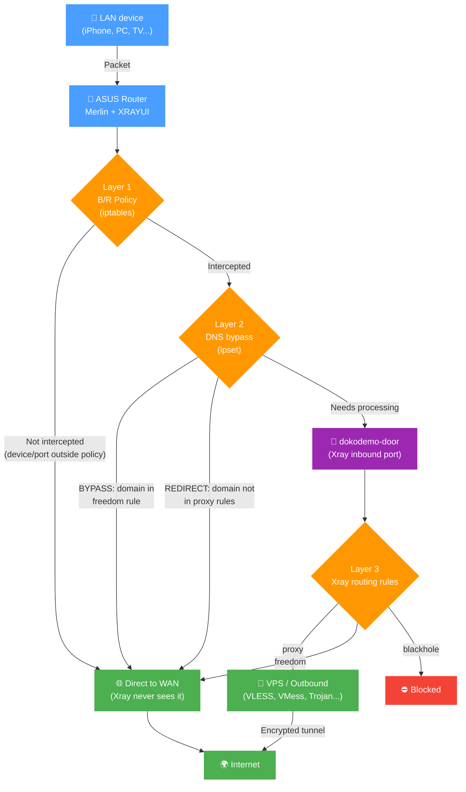
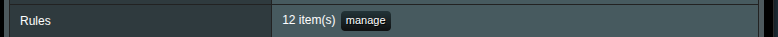
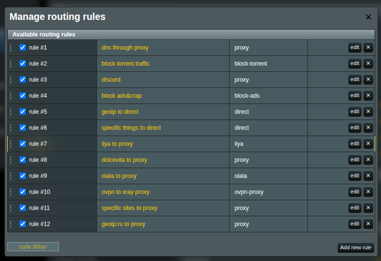
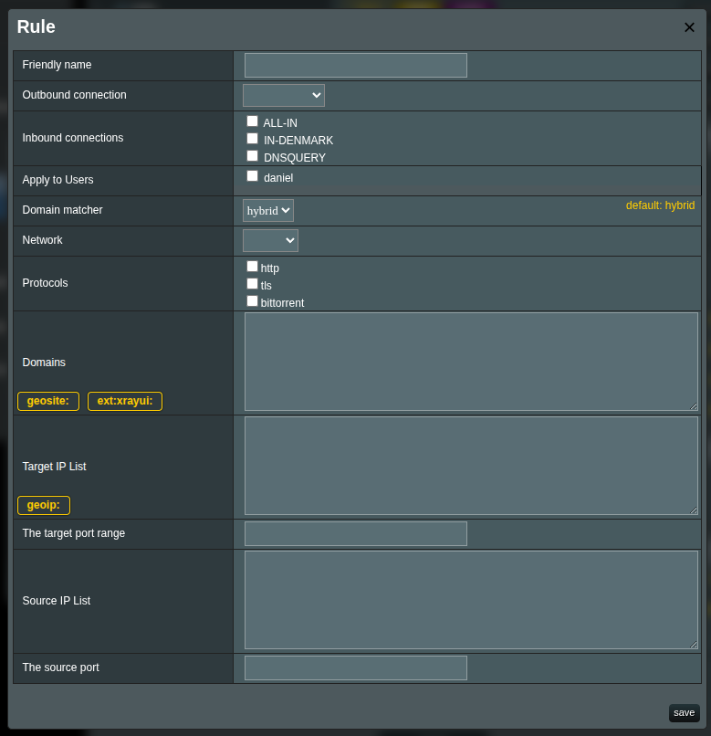

# Routing Rules

Routing rules determine which outbound handles specific traffic: proxy, direct (`freedom`), or block (`blackhole`). Rules are evaluated **top to bottom** — first match wins.

## How Traffic Reaches Xray

Not all traffic automatically goes through Xray. There are three processing layers, and each one only works with what passed through the previous one.



> [!note]
> Before any of the three layers, XRAYUI unconditionally excludes service traffic: DHCP (67/68), NTP (123), IPsec/WireGuard (500/4500/4501/51820), multicast/broadcast, packets originated by the router itself, and traffic already in a DNAT state (inbound port-forwards). These packets never reach Xray, even if a policy would otherwise intercept them.

### Layer 1: Interception (B/R Policies)

[Bypass/Redirect policies](br-policy.md) determine which devices and ports are intercepted. Traffic that isn't intercepted goes direct — Xray never sees it.

### Layer 2: DNS Bypass (before Xray)

Intercepted traffic can be further filtered **before** reaching Xray. This reduces router CPU load but limits routing flexibility.

By default, all intercepted traffic is redirected to Xray's dokodemo-door inbound port. On weak routers, this creates high CPU load under heavy traffic. DNS bypass solves this by filtering traffic at the iptables/ipset level before Xray.

#### Modes

- **OFF** — all intercepted traffic goes to Xray. Routing rules work fully.

- **BYPASS** — extracts domains from rules with `freedom` outbound type. Traffic to those domains **skips Xray** and goes direct. For example, a rule `domain:ru` → `freedom` means all `.ru` traffic bypasses Xray. Everything else enters Xray.

- **REDIRECT** — inverse of BYPASS. Extracts domains from rules with outbound type **other than** `freedom`, and only that traffic enters Xray. For example, a rule `geosite:youtube` → `proxy` means only YouTube traffic enters Xray; everything else goes direct.

> [!important]
> DNS bypass operates **before** Xray routing rules. Traffic filtered at this layer never reaches Xray, and routing rules won't apply to it.

> [!note]
> Geodata categories occasionally contain entries with the `regexp:` prefix. These are ignored by DNS bypass — ipset doesn't support regular expressions.

### Layer 3: Xray Routing Rules

Traffic that passes through the previous layers is processed by Xray's routing rules — the rest of this document covers them.

## Domain Syntax

### Prefixes

| Prefix        | Behavior                  | Example                                                   |
| ------------- | ------------------------- | --------------------------------------------------------- |
| `domain:`     | Domain + all subdomains   | `domain:google.com` → `google.com`, `maps.google.com`     |
| `full:`       | Exact match only          | `full:google.com` → only `google.com`                     |
| `keyword:`    | Contains substring        | `keyword:google` → `google.com`, `mygooglesite.net`       |
| `regexp:`     | Regular expression        | `regexp:.*\.edu$` → `harvard.edu`, `mit.edu`              |
| `geosite:`    | Geosite database category | `geosite:netflix` → all Netflix domains                   |
| `ext:xrayui:` | Custom domain list       | `ext:xrayui:mylist` → domains from your custom list       |

### `domain:` matching examples

- `domain:com` — all `.com` domains and their subdomains
- `domain:dmn.com` — `dmn.com`, `www.dmn.com`, `sub.domain.dmn.com`
- `domain:www.dmn.com` — only `www.dmn.com` and its subdomains, not `dmn.com`

## Geosite Databases

Geosite files are community-maintained lists of domains grouped by category. Instead of manually listing dozens of domains for a service, you can use a single category tag.

Example — `geosite:youtube` includes `youtube.com`, `youtu.be`, `youtube-nocookie.com`, CDNs, regional domains, etc.

### Common Categories

| Category                       | Description                    |
| ------------------------------ | ------------------------------ |
| `geosite:google`               | All Google services            |
| `geosite:youtube`              | YouTube and related domains    |
| `geosite:netflix`              | Netflix                        |
| `geosite:facebook`             | Facebook and Instagram         |
| `geosite:twitter`              | Twitter/X                      |
| `geosite:telegram`             | Telegram                       |
| `geosite:spotify`              | Spotify                        |
| `geosite:category-ads-all`     | Ad networks                    |
| `geosite:category-media-ru`    | Blocked media in Russia        |
| `geosite:cn`                   | Chinese domains                |
| `geosite:geolocation-!cn`      | Non-Chinese domains            |

Full list of categories: [v2fly/domain-list-community](https://github.com/v2fly/domain-list-community/tree/master/data)

### Updating Databases

**Manual:** Routing → **Update community files** → Apply

**Automatic:** General Options → Geodata → **Auto-update geodata files** (updates at 03:00)

### Custom Lists

You can create your own domain categories and use them in rules as `ext:xrayui:name`. Details: [Geodata Files Manager](custom-geodata).

## GeoIP

| Category           | Description             |
| ------------------ | ----------------------- |
| `geoip:cn`         | Chinese IP addresses    |
| `geoip:us`         | US IP addresses         |
| `geoip:private`    | Private/LAN addresses   |
| `geoip:cloudflare` | Cloudflare IPs          |

## Managing Rules

### Interface

1. Go to the **Routing** section
   
2. Click **Manage** next to **Rules**
   

### Adding a Rule

Click **Add new rule**. Fill in the fields:

| Field                   | Description                                 |
| ----------------------- | ------------------------------------------- |
| **Friendly Name**       | Descriptive name for the rule               |
| **Outbound connection** | Where to send traffic: proxy, direct, block |
| **Enabled**             | Toggle rule on/off                          |

### Matching Criteria



A rule can have one or more criteria. When multiple are specified, **AND** logic applies — all conditions must match.

> [!tip]
> If nothing is selected in a field, everything matches. You don't need to select all options to cover all traffic — just leave the field blank.

#### Domains

One per line. Supported formats: `domain:`, `full:`, `keyword:`, `regexp:`, `geosite:`, `ext:xrayui:`.

> [!tip]
> The **geosite:** and **ext:xrayui:** buttons above the input field insert the prefix. Autocomplete helps find available tags.

#### IP Addresses

```text
192.168.1.1
192.168.1.0/24
geoip:cn
geoip:private
```

#### Source IPs

Filter by source device IP:

```text
192.168.1.100
192.168.1.0/24
```

#### Ports

```text
443
8080:8090
```

> [!note]
> Use colon (`:`) for ranges, not a hyphen.

#### Networks

- **tcp** — TCP only
- **udp** — UDP only (including QUIC/HTTP3)
- Empty — both

#### Protocols

- **http**, **tls**, **bittorrent**, **quic**

Detected by packet inspection, not port numbers.

### Rule Order

Use the up/down buttons to reorder rules. More specific rules go higher, catch-all rules at the bottom.

### Moving Rules to Another Outbound or Inbound

To send a rule to another outbound or balancer, pick it in the rule's row in **Manage routing rules**. You don't have to open the rule.

To change many rules at once, click **Reassign…**:

- **Change: Outbound or balancer** moves every rule from one outbound or balancer to another, for example from `proxy-swiss` to `proxy`.
- **Change: Inbound** replaces one inbound with another in every rule that lists it. **— remove from rules —** takes it out of the rules instead, which is what you need before deleting an inbound. A rule that lists only that inbound is left unchanged, because a rule with no inbound applies to traffic from every inbound. Delete such rules or move them to another inbound.

Choose **From** and **To**, and click **Reassign**. The number next to each **From** entry is how many rules use it. Disabled rules change too.

> [!tip]
> If you switch servers often, point the rules at a balancer whose selector picks only that one outbound. Switching servers is then one change in the balancer instead of one per rule. The selector matches the start of the tag, so `proxy` also selects `proxy-swiss`.

### Saving

1. **Save** in the rule editor
2. **Apply** on the main page

### System Rules

Some rules are auto-generated (DNS, B/R policies). They can't be edited directly but can be disabled.

### Disabling Rules

Uncheck a rule's checkbox — it moves to the "disabled" section and retains its configuration.

## Example Rules

### Netflix via proxy

```yaml
Friendly Name: Netflix proxy
Outbound: proxy
Domains: geosite:netflix
```

### Block ads

```yaml
Friendly Name: Block ads
Outbound: block
Domains: geosite:category-ads-all
```

### Local network direct

```yaml
Friendly Name: LAN direct
Outbound: direct
IPs:
  geoip:private
```

### Torrents direct

```yaml
Friendly Name: Torrents direct
Outbound: direct
Protocols: bittorrent
```

### Specific device HTTPS via proxy

```yaml
Friendly Name: Laptop HTTPS proxy
Outbound: proxy
Source IPs: 192.168.1.100
Ports: 443
Networks: tcp
```

## Common Routing Schemes

### Proxy everything except local

```yaml
Rule 1 — direct: IPs: geoip:private
Rule 2 — proxy:  (empty criteria = catch-all)
```

### Only specific services via proxy

```yaml
Rule 1 — proxy:  Domains: geosite:netflix, geosite:youtube
Rule 2 — direct: (catch-all)
```

### Bypass regional restrictions (Russia)

```yaml
Rule 1 — proxy:  Domains: geosite:category-media-ru
Rule 2 — direct: Domains: geosite:ru
Rule 3 — proxy:  Domains: geosite:geolocation-!ru
```

### Performance optimization with DNS bypass

```yaml
DNS Bypass: REDIRECT mode
B/R Policy: Redirect ports 80,443

Rules:
1. geosite:youtube → proxy
2. geosite:netflix → proxy
```

Only YouTube and Netflix go through Xray. Everything else bypasses at the iptables level.

### Maximum control

```yaml
DNS Bypass: OFF
B/R Policy: Redirect all

Rules:
1. domain:company.com → work-proxy
2. geosite:netflix → us-proxy
3. geosite:twitter → europe-proxy
4. ports:27000-27100 → direct
5. (catch-all) → proxy
```

All traffic goes through Xray for evaluation.

## Advanced

### Balancers

Balancers distribute traffic across multiple outbound connections. Instead of routing to a single outbound, a rule can route to a balancer, which then selects the best outbound based on the configured strategy.

#### When to use balancers

- You have multiple proxy servers and want to spread load across them
- You want automatic failover if one server goes down
- You want to route to the lowest-latency server

#### Managing balancers

1. Go to the **Routing** section
1. Click **Manage** next to **Balancers**
   

1. Click **Add** to create a new balancer
   

#### Balancer fields

| Field                 | Description                                                                              |
| --------------------- | ---------------------------------------------------------------------------------------- |
| **Tag**               | Unique identifier. Used to reference this balancer from routing rules via balancerTag.   |
| **Strategy**          | How the balancer picks an outbound (see below).                                          |
| **Selectors**         | Prefix patterns to match outbound tags. One per line. E.g., `us-` matches `us-1`.        |
| **Fallback outbound** | Outbound to use if all matched outbounds are unavailable. Requires observatory.          |

#### Strategies

| Strategy       | Description                                                                 |
| -------------- | --------------------------------------------------------------------------- |
| `random`       | Randomly selects a matched outbound. **(Default)**                          |
| `roundRobin`   | Selects matched outbounds in sequential order.                              |
| `leastPing`    | Selects the outbound with the lowest latency. Requires observatory.         |
| `leastLoad`    | Selects the most stable outbound based on observations. Requires observatory. |

> [!note]
> The `leastPing` and `leastLoad` strategies require `observatory` or `burstObservatory` configuration in your Xray config to function. Without it, they behave like `random`.

#### Selector matching

Selectors use **prefix matching** against outbound tags. For example:

| Outbound tags                      | Selector | Matched                  |
| ---------------------------------- | -------- | ------------------------ |
| `us-1`, `us-2`, `eu-1`, `eu-2`    | `us-`    | `us-1`, `us-2`           |
| `proxy-a`, `proxy-b`, `direct`    | `proxy-` | `proxy-a`, `proxy-b`     |
| `fast`, `fallback`                | `f`      | `fast`, `fallback`       |

The edit form shows a live preview of matching outbounds below the selector field.

#### Using balancers in rules

When editing a routing rule, choose **Balancer** as the target type instead of **Outbound**:


Then select the balancer tag from the dropdown. Rules with a balancer target show a ⚖ icon in the rules list.

> [!important]
> A rule can have either `outboundTag` or `balancerTag`, not both. Switching the target type clears the other field.

#### Example: Round-robin across US proxies

1. Create outbounds: `us-east`, `us-west`, `us-central`
2. Create a balancer:

   ```yaml
   Tag: us-balance
   Strategy: roundRobin
   Selectors: us-
   ```

3. Create a routing rule:

   ```yaml
   Friendly Name: US traffic balanced
   Target type: Balancer
   Balancer: us-balance
   Domains: geosite:netflix, geosite:youtube
   ```

#### Example: Failover with fallback

1. Create outbounds: `primary-proxy`, `backup-proxy`
2. Create a balancer:

   ```yaml
   Tag: failover
   Strategy: leastPing
   Selectors: primary-
   Fallback outbound: backup-proxy
   ```

3. Route traffic to the `failover` balancer. If `primary-proxy` becomes unreachable, traffic automatically falls back to `backup-proxy`.

## Troubleshooting

### Rules not working

1. **DNS bypass** — traffic may be filtered before Xray. Temporarily set to OFF to test.
2. **B/R policies** — traffic may not be intercepted. Check MAC addresses and ports.
3. **Rule order** — specific rules must be above general ones.
4. **Outbound** — verify the specified outbound exists.
5. **Syntax** — `domain:` not `domain.`, `geosite:` not `geosite.`.

### Traffic not being proxied

- DNS bypass in REDIRECT mode with the domain matching a `freedom` rule
- B/R policy doesn't include the needed ports
- QUIC/HTTP3 (UDP 443) not intercepted — add UDP 443 to the policy

### Unexpected direct connections

- Ipset rules from DNS bypass creating kernel-level bypasses
- IPv6 traffic not being handled
- Cached DNS responses from a previous configuration

### Debugging

Enable logs: General Options → Logs → **Access logs**, level `info` or `debug`.

```bash
tail -f /tmp/log/xray_access.log
```

> [!note]
> After any changes, click **Apply** on the main page to activate the new configuration.
