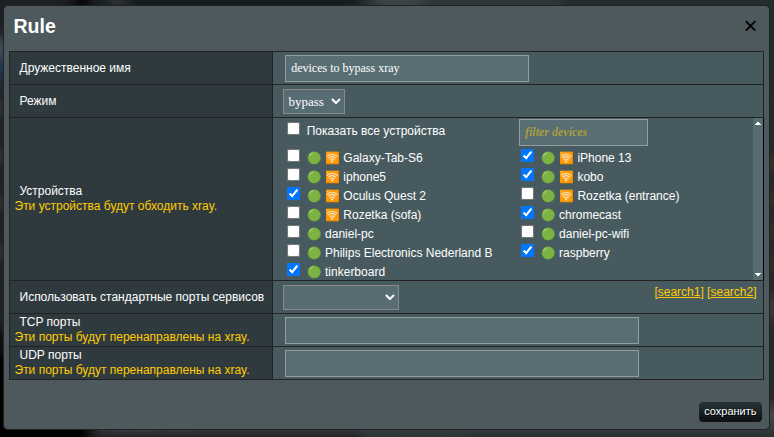
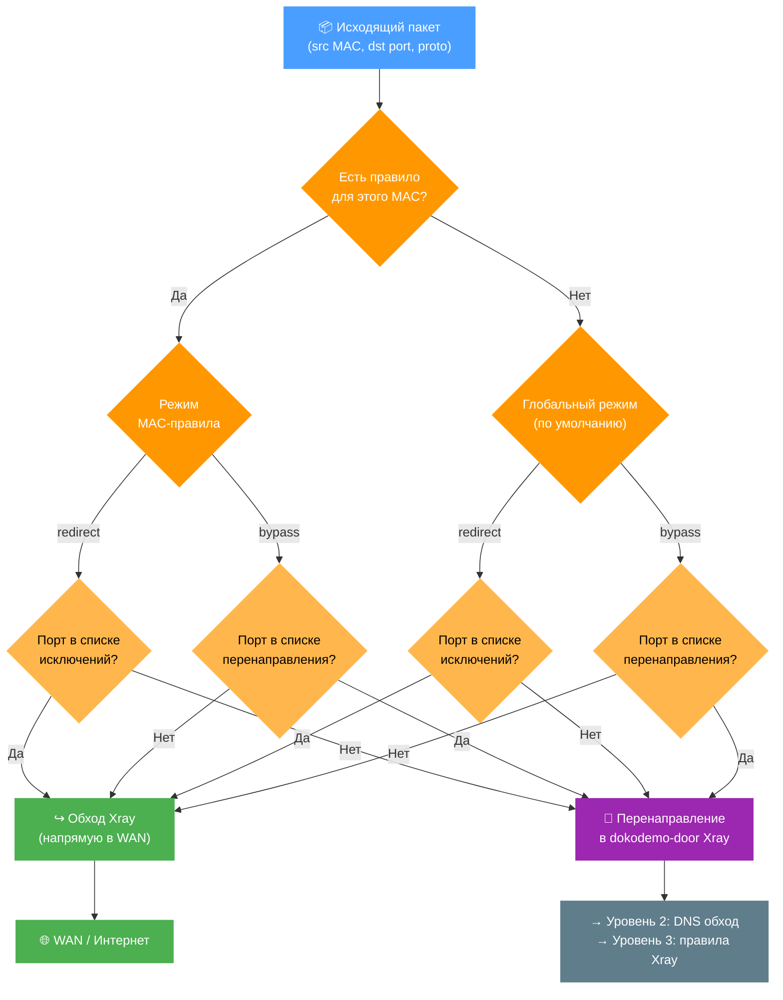

# Политика обхода/перенаправления

Политика `Bypass/Redirect Policy` позволяет тонко настроить обработку трафика Xray на уровне порта или устройства (MAC-адреса).

- **Bypass** означает, что трафик по умолчанию **не** проходит через Xray, если только вы явно не укажете порты для перенаправления.
- **Redirect** означает, что трафик по умолчанию **проходит** через Xray, если только вы явно не исключите определённые порты.

> [!info]
> Политики B/R — это правила, применяемые непосредственно перед маршрутизацией трафика через службу Xray.

## Зачем использовать?

У вас могут быть устройства или приложения, которые вы не хотите проксировать — например, внутренние сервисы или локальные игровые серверы.



Наоборот, вы можете захотеть проксировать только конкретные порты (например, `443`), оставив весь остальной трафик нетронутым.

Или вам может понадобиться, чтобы конкретное устройство (например, ваш ПК) полностью перенаправлялось через Xray, при этом исключив определённые порты для этого устройства.

Эта гибкая система политик позволяет реализовать все эти сценарии и многое другое.

## Схема политики


Чтобы управлять политиками B/R, нажмите кнопку **Manage** в разделе **Routing**.

> [!info]
> По умолчанию, если правила не указаны, применяется динамическое общее правило: **весь трафик перенаправляется** в процесс Xray.

## Логика принятия решения

Ниже показано, как XRAYUI решает, перехватывать ли конкретный пакет. Проверка выполняется на уровне iptables перед тем, как трафик попадёт в Xray.



> [!tip]
> Правило для конкретного MAC всегда побеждает глобальное. Порты — это «исключения из режима»: в `redirect` они обходят Xray, в `bypass` — наоборот, направляются в Xray.

## Примеры

Ниже приведена таблица, упорядоченная от самой простой конфигурации (только выбор режима) к более детализированным (указание портов и устройств). Это помогает показать, как разные комбинации влияют на итоговое поведение.

| #   | Конфигурация           | Пример (упрощённо)                  | Влияние на устройства                                                                                       |
| --- | ---------------------- | ----------------------------------- | ----------------------------------------------------------------------------------------------------------- |
| 1   | Только bypass          | mode: bypass, no MAC/ports          | Весь трафик `bypasses` Xray (ничего не перенаправляется).                                                   |
| 2   | Только redirect        | mode: redirect, no MAC/ports        | Весь трафик `redirected` в Xray (исключённых портов нет).                                                   |
| 3   | bypass + port          | mode: bypass, tcp/udp=5060          | Трафик на порту 5060 `redirected` в Xray; весь остальной трафик обходит Xray.                               |
| 4   | redirect + port        | mode: redirect, tcp/udp=5060        | Трафик на порту 5060 `bypasses` Xray; весь остальной трафик перенаправляется.                               |
| 5   | bypass + MAC           | mode: bypass, mac=AA:BB...          | Весь трафик для этого устройства `bypasses` Xray (порты для перенаправления не указаны).                    |
| 6   | redirect + MAC         | mode: redirect, mac=AA:BB...        | Весь трафик для этого устройства `redirected` (исключённых портов нет). Другие устройства не затрагиваются. |
| 7   | redirect + MAC + ports | mode: redirect, mac=..., ports=5060 | Для этого устройства: трафик на порту 5060 обходит Xray; весь остальной трафик `redirected`.                |
| 8   | bypass + MAC + ports   | mode: bypass, mac=..., ports=5060   | Для этого устройства: трафик на порту 5060 перенаправляется в Xray; весь остальной трафик `bypasses` Xray.  |

## Родительский контроль и фильтр сетевых служб

**Родительский контроль** прошивки (расписание и блокировка) и **фильтр сетевых служб** (Network Services Filter) добавляют правила только в цепочку iptables `FORWARD`. Трафик, который XRAYUI перенаправляет в Xray, через `FORWARD` не проходит: он доставляется в Xray на самом роутере, а Xray открывает собственное соединение уже от роутера. Поэтому эти правила прошивки **не действуют** на устройства, чей трафик идёт через Xray. Если одна из этих функций включена, XRAYUI пишет предупреждение в системный журнал.

Сохранить расписание можно двумя способами:

- **Не пускать устройство в Xray.** Добавьте политику `bypass` с MAC-адресом устройства без портов (строка 5 в таблице выше). Его трафик снова пойдёт через `FORWARD`, и расписание прошивки заработает, но устройство перестанет проксироваться.
- **Оставить устройство в Xray и блокировать его самостоятельно** в хуке **After firewall start** (**General Options** → **Hooks**). Правило должно стоять в `PREROUTING`, потому что именно там XRAYUI забирает трафик. Например, чтобы отключить интернет одному устройству с 22:00 до 07:00 (по времени роутера), оставив доступ к роутеру и локальной сети:

```sh
MAC="AA:BB:CC:DD:EE:FF"
LAN="192.168.50.0/24"
TIME="-m time --timestart 22:00 --timestop 07:00 --kerneltz"
RULE4="-i br0 -m mac --mac-source $MAC ! -d $LAN -m addrtype ! --dst-type BROADCAST,MULTICAST $TIME -j DROP"
RULE6="-i br0 -m mac --mac-source $MAC ! -d fe80::/10 -m addrtype ! --dst-type LOCAL,MULTICAST $TIME -j DROP"

while iptables -t mangle -D PREROUTING $RULE4 2>/dev/null; do :; done
iptables -t mangle -I PREROUTING 1 $RULE4

if ip6tables -t mangle -L PREROUTING -n >/dev/null 2>&1; then
    while ip6tables -t mangle -D PREROUTING $RULE6 2>/dev/null; do :; done
    ip6tables -t mangle -I PREROUTING 1 $RULE6
fi
```

> [!important]
> Оставляйте обе части: `RULE4` для IPv4 и `RULE6` для IPv6. Без `RULE6` устройство с IPv6 продолжит выходить в интернет в запрещённые часы. Хук при каждом запуске удаляет правило и вставляет его заново наверх, потому что XRAYUI при каждом старте Xray ставит в начало `PREROUTING` своё правило для уже открытых соединений. Если ваше правило окажется ниже, соединения, открытые до начала запрета, продолжат работать.

> [!note]
> У клиентов VPN-сервера роутера (WireGuard, IPsec) нет MAC-адреса. Для них используйте интерфейс и адрес, например `-i wgs1 -s 10.6.0.2`.
